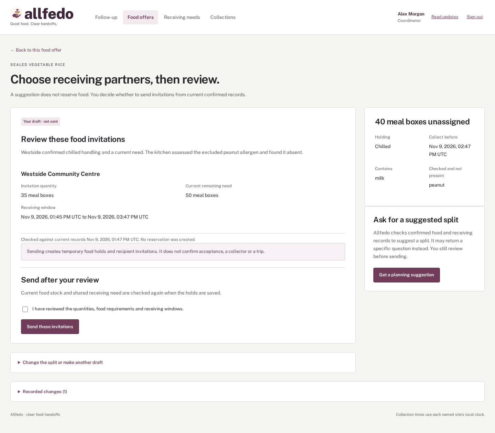

# Allfedo

**Surplus food. Agreed pickups. Confirmed receipts.**

Allfedo connects known kitchens and shelters through a local food-rescue coordinator. An AI agent helps choose suitable receiving partners. People agree the quantities and transport, then record what actually changed hands.

When a pickup is short or a receiving door is closed, the app keeps the remaining food visible, with someone responsible and a clear next action.



*The signed-in coordinator view, using fictional partners and a checked manual plan.*

## From an offer to an accepted meal

1. **Confirm today's facts.** Kitchens record counted meal boxes, ingredients, packaging and collection times. Receiving teams confirm their total need, receiving hours and handling requirements.
2. **Review the proposed match.** The native IRIS AI Hub agent reads the authorized facts and proposes a split, or asks for missing information. The coordinator reviews and sends separately.
3. **Make the agreement.** Receiving teams accept an exact quantity. An assigned collector confirms the load, destination and arrival. Shared food and receiving capacity are checked when commitments are saved.
4. **Record the handoff.** The kitchen records the actual collection. Receiving staff count the boxes they accept. The original agreement remains available beside the physical reports.

## Handle the day that did not go to plan

| What changes | How Allfedo follows through |
|---|---|
| Fewer boxes leave or arrive | Keep promised, collected, accepted and unresolved quantities separate. |
| Food or instructions change | Preserve the original ticket and request the relevant new confirmations. |
| The destination is unavailable | Confirm the food still carried, find another receiving team and agree the onward arrival. No second pickup is invented. |
| Food is rejected, returned or disposed of | Follow the same portion through linked reports without counting it twice. Returns stay quarantined. |
| A report is late or wrong | Keep its physical time and correction history; pause unsupported new commitments. |
| A save response, model call or email fails | Recover the original request, show the actual state and keep the next action available. |

[See an onward collection on a phone](doc/assets/onward-delivery.png).

## Built on InterSystems IRIS

IRIS runs the **Production**, its native integration workflow. A Business Service receives signed-in commands; a Business Process routes planning to the native AI Hub agent and other actions to the saved rescue rules.

The agent uses OpenAI to make a proposal. Its case-scoped tools cannot reserve food or approve a pickup. Embedded Python checks proposed invitations and reconciles physical stock inside IRIS. Reviewed commitments are saved in short database transactions. A saved notification queue sends email with bounded retries.

The browser uses standard JavaScript modules, with responsive views for kitchens, receiving teams, collectors and coordinators. It needs no frontend build step or production package dependency.

## Run locally

Requires **Docker Compose** and **Python 3.10+**. The tested runtime is **AI Hub Community `2027.1.0AI.109.0`**. Download its licensed Docker archive for your CPU from the [official AI Hub portal](https://evaluation.intersystems.com/Eval/early-access/AIHub).

Create `.env` from [.env.example](.env.example). Set your own `OPENAI_API_KEY`; `OPENAI_MODEL` defaults to `gpt-4.1-mini`. Live planning uses paid provider calls. Setup and ordinary tests do not. Checked manual planning is available without a key.

```bash
python3 scripts/iris_runtime.py /path/to/iris-community-2027.1.0AI.109.0-docker.tar.gz --setup
python3 scripts/demo.py
```

Open **<http://127.0.0.1:52773/allfedo/>**. The second command creates six local accounts across four fictional partner sites. Read their generated credentials privately in `.env.demo.json`. Reruns preserve accounts and case history. The [sample journey](doc/DEMO.md) takes you through a complete collection.

Email appears in the local [Mailpit test inbox](http://127.0.0.1:8025). Services bind to the local machine; named volumes preserve data. The proprietary image and private settings are not redistributed.

[Installation details and troubleshooting](doc/INSTALLATION.md).

## Develop and verify

```bash
python3 -m unittest discover -s tests -q
docker compose config --quiet
python3 scripts/iris_runtime.py --test
```

Browser checks also require **Node.js 20+**:

```bash
npm ci
npx playwright install chromium
npm run test:time
npm run test:transport
npm run test:browser
```

The checks exercise real native commands, competing reservations, role permissions, physical outcomes, notification delivery and independent signed-in browser sessions. A fresh installation and the complete recovery journey have passed on the stated runtime. [Validation results and measured agent usage](doc/VALIDATION.md).

For contributors: [architecture](doc/ARCHITECTURE.md), [partner API](doc/API.md), [browser source guide](src/web/README.md) and [native checks](tests/native/README.md).

## Scope and license

This release supports whole meal boxes, known partners and human-confirmed transport. It does not calculate routes, certify food safety or run a public driver marketplace. Demo data and physical events are fictional; the service has not been field-validated.

Allfedo is [MIT licensed](LICENSE). Vendor software and bundled assets retain their own terms. Built by [Snow Sadh](https://openexchange.intersystems.com/user/snow%2520sadh/AEXFstiBwfewHtVmKbTfiU73Vc).
