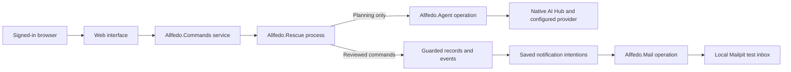

# How Allfedo works

Allfedo runs on AI Hub Community `2027.1.0AI.109.0`. Native and browser checks cover the integration, changed destinations and linked rejected-food movements.

## Follow one command

A receiving contact accepts 30 meal boxes. The browser sends `request_id`, `action: "accept"`, and a payload containing the collection ID, revision and quantity. A **revision** identifies the saved version the person reviewed. A **request ID** identifies this one intention across retries.

IRIS's native sign-in supplies account identity. The browser cannot choose its trusted role or actor. The web interface checks membership and sends a typed command through the Production, IRIS's integration workflow.

The Business Service resolves the native account again and overwrites any supplied actor ID. The Business Process routes planning to the agent and other commands to saved rescue rules. Acceptance converts a hold into a promise; it does not prove transport or collection.

Cases wait in saved records while people respond. No database transaction or worker stays open waiting for a person, model or email server. This release uses one Business Process with separate saved offers and collections.

## Find the responsibilities

Paths below are relative to `src/Allfedo/` unless shown otherwise.

| Source | Owns |
|---|---|
| `Web/` | Native sign-in, scoped reads, browser commands and named static files. |
| `CommandService.cls`, `RescueProcess.cls` | Native messages and trusted account handoff. |
| `Rescue.cls` | Command identity, permissions, resource locks, transactions and ordinary agreements. |
| `Facts.cls` | Confirmed partner places, food details and receiving needs. |
| `Recovery.cls` | Physical reports, promise changes and stock reconciliation. |
| `Trip.cls` | Current trip instructions, receiving consent and preserved collector agreements. |
| `Redirect.cls` | Collector-reported problems, new receiving consent and linked onward collections. |
| `Policy.cls`, `src/python/allfedo/` | Strict input parsing, proposal checks and physical-stock calculation. Python runs inside IRIS. |
| `CaseTools.cls`, `Operation/Agent.cls` | Case-scoped tools and the bounded native AI Hub decision. |
| `AISettings.cls` | Default provider, personal session keys in the native secure wallet and default-key allowance. |
| `OutboxService.cls`, `Operation/Mail.cls` | Saved notifications, bounded retries and actual test email. |
| `Record/` | Stored accounts, sites, facts, commitments, physical reports and history. |
| `src/web/` | Role-specific screens, forms, local times and request recovery. No production package dependency or build step. |

[Browser details](../src/web/README.md) explain navigation and rendering. [Native checks](../tests/native/README.md) explain integration verification.

## Keep shared quantities correct

An offer is one lot with one set of food facts. This release accepts whole `meal_box` quantities only. Different food conditions need separate offers. Trays or kilograms never become meal boxes through guessed conversions.

Receiving need is shared across kitchens. If two kitchens each request 35 boxes against a need of 50, both cannot succeed. Real concurrent IRIS-process checks exercise this conflict.

Every modifying command enters `Rescue.Execute`. It acquires the request lock, then affected resource locks in a consistent order. Inside one short transaction it reloads current records, checks permissions and revisions, and saves changes, outcome, event and notification intentions together. Failed changes roll back. A temporary busy result is not saved as a permanent rejection.

Acceptance releases any unaccepted part of the hold. An explicit expiry command can release an elapsed unaccepted invitation. An accepted or collected case never becomes available food merely because time passed.

A coordinator or receiving partner assigns an approved collector; only that collector can agree their trip. The server checks overlapping assignments and unresolved earlier custody. The collector confirms the load and handling. The app does not infer vehicle fit or driving time.

## Preserve physical truth and changed promises

Declaration, on-hand count, handoff, receipt and disposition are different facts. Each physical report keeps its actor, claimed occurrence time, recorded time and source. A stale screen or missed deadline may require review; it must not erase food that physically moved.

The stock calculation reconciles the latest kitchen count with movements before and after that physical instant. Late reports already included in the count are not subtracted twice. Returned food stays quarantined. Ambiguous or impossible history blocks new stock promises. Fractional times are preserved; a row ID does not prove physical order.

A correction appends a report and retains the superseded source. The responsible reporting party has permission to correct it. Corrections undermining an earlier settlement pause replacement capacity for fresh receiving confirmation.

An agreed trip preserves places, entrances, contacts, load, food facts and supporting identities. Current partner details remain separate. Changed instructions require relevant receiving consent and the collector's new agreement. Consent cannot override incompatible allergens, missing assessments or handling limits.

A coordinator can propose a smaller promise or cancellation. The old promise remains until required people confirm current facts. Releasing an unhanded promise requires the kitchen's actual count. Resolving a transit loss does not return those boxes to kitchen stock.

For example, 20 boxes were handed over, 18 accepted and two confirmed lost. Replacement demand is not automatic. The receiving partner confirms its full current need: total 20 leaves two available to replace; total 18 leaves none. Original promise, current promise, physical receipt, known outcomes and unknown custody remain distinct.

If a destination becomes unavailable after pickup, the collector first reports the actual carried quantity, location and holding. A new invitation holds receiving capacity only. Acceptance creates a linked collection; it never subtracts kitchen stock again. The collector agrees the new destination against the whole remaining carried load. Permissions keep each receiving team's private case separate.

Later return or disposal of rejected food points to its original custody report through `FromCustodyId`. Corrections preserve that logical link. The calculation follows the same portion rather than counting each movement as another loss. Excess reports remain visible for review; they do not borrow another portion. A kitchen return remains quarantined.

## Retry and notify without inventing outcomes

The command stores caller, request ID, action, original payload and outcome. Repeating that exact intention returns its saved result. Reusing its ID with changed input is rejected. The browser saves only an unfinished request reference before sending, scoped to the signed-in actor. Reloading can check that ID. IRIS remains the only food ledger.

An **outbox** is a saved notification intention. It commits with the business change. A native scheduled service leases due rows for delivery. The outbox owns up to five attempts with increasing delays; the mail operation does not start another retry loop. A lost email acknowledgement may cause a duplicate email linking to the same case.

Guards depend on purpose. Invitations need their current hold and reply window. Pending changes request only replies still needed. Applied changes and withdrawals remain factual updates after a case advances. The addressed account must remain active and authorized, with its saved email address. Other approved staff in that organization may respond through their own accounts.

Links use configured `ALLFEDO_PUBLIC_URL`, not browser request headers. Mailpit is a local test destination; no real partner email is claimed. Mail-server acceptance does not prove reading, agreement, collection or receipt.

## Give the model a useful, bounded job

`%AI.Provider`, `%AI.Agent` and `%AI.ToolSet` are native AI Hub interfaces. The selected provider supplies the model; Allfedo supplies authorized case facts and tools. OpenAI is the live-tested default. No model weights are trained or modified. `gpt-4.1-mini` is the verified compatibility baseline, not a measured best-model claim.

The agent reads an authorized snapshot of food and receiving needs taken at planning start. Tools also expose recorded collection agreements and permitted sources. Its tools are `ReadOffer`, `ReadCurrentNeeds`, `ReadCollectionFacts`, `ReadCaseEvidence`, `SubmitProposal` and `RequestReview`. Source text is untrusted data. There is no arbitrary SQL, file, shell or booking tool.

The agent chooses a recipient split or a concrete review question. Python checks IDs, units, quantities, snapshot revisions, required evidence, windows, allergens and handling. A passing proposal reserves nothing. The coordinator reviews and sends separately; saving holds checks authoritative records again under locks.

Limits are four tool rounds, 1,200 configured output tokens, ten-second connection and twenty-second request timeouts, plus a ninety-second case deadline. These are bounds, not promised response times. Failed or interrupted attempts stay visible. Rechecking a request does not silently start another billed decision. A checked manual plan remains available.

AgentRun stores the snapshot, configured provider and model, default or personal connection source, proposal or failure, tool audit and start/end times. Native usage is optional and separately labelled; missing values remain unknown. Production business-message trace does not imply a separate trace record for every underlying provider exchange.

Personal-key settings use a direct authenticated web endpoint rather than the business-message queue. The native wallet stores the key; session metadata keeps only the owning actor, provider, model and expiry. A planning message carries an opaque reference. The worker verifies its owner and expiry before reading the wallet. Signing out or selecting the default deletes the key. Expired entries cannot be used and are removed on later settings access.

Default-key attempts are counted against saved AgentRun rows under a short allowance lock. The default is 50 per UTC day; an interrupted request keeps its existing result and does not reserve another attempt. No provider call runs while that lock is held. Existing AgentRun storage slots are preserved; provider and connection source append new slots.

## Access, storage and operating limits

Native sessions supply kitchen, receiving, collector or coordinator membership. Lists and direct links apply the same network and organization or assignment checks. JSON writes require the app request header and same-origin checks. Browser users receive no general Embedded Python execution privilege; Python checks run in trusted workers.

Code and data use separate databases. The login gateway can read code without reading partner data. Stored-field `Storage` blocks retain native slot numbers, so adding a property does not reinterpret older records. Setup stops Allfedo workers before compiling and restarts them afterward; compilation alone does not prove an old worker loaded new code.

Docker volumes retain application and inbox data. The licensed image and private settings stay local. Only source folders are mounted into IRIS. Public deployment, real email, partner onboarding and handling procedures need the operating network's own configuration and validation. There are no partner interviews, physical rescue trials, automatic travel guarantees or certified food-safety decisions.

Original source uses the MIT license. Native interfaces follow the [AI Hub guide](https://github.com/intersystems-community/ai-hub-eap/blob/1cca39afeb069413846c4c31196eed0b731f793a/ObjectScript_SDK_Guide.md) and were checked on build 109.
